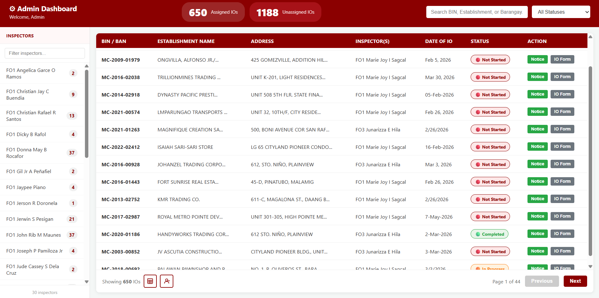
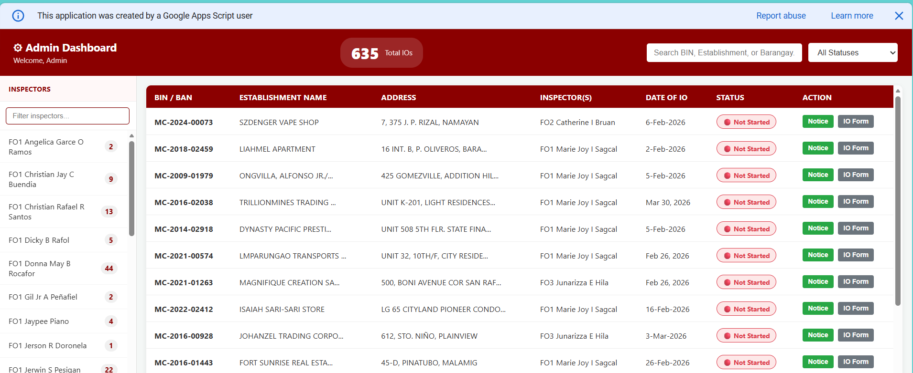
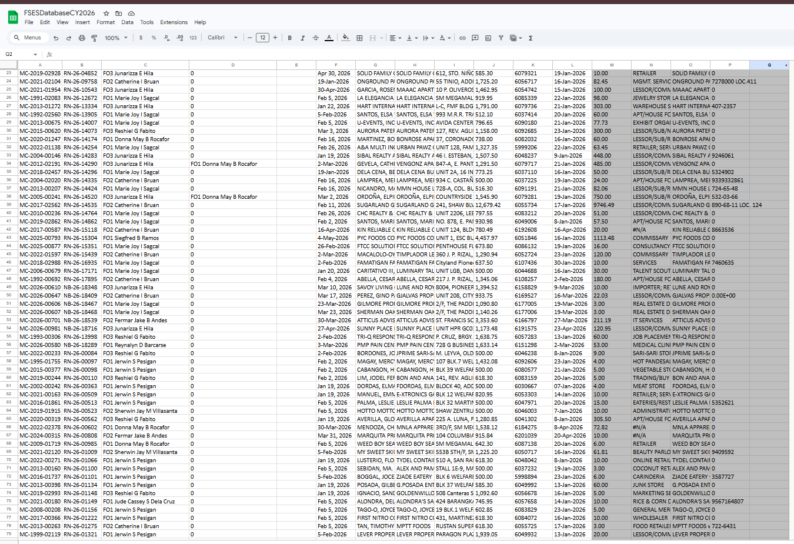
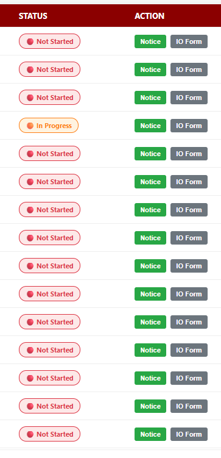

# BFP Mandaluyong Inspection Order Management System

An automated, role-based inspection order and document management platform developed during my Internship / On-the-Job Training at the Bureau of Fire Protection (BFP) Mandaluyong.

---

##  Project Overview
Managing and syncing physical inspection logs and official documentation manually created administrative bottlenecks. This system was built to automate cross-platform data synchronization, secure administrative access control, and accelerate official document generation.

---

##  Tech Stack & Integrations
- **Core Scripting:** Google Apps Script (JavaScript-based backend logic)
- **API Integration:** Microsoft Graph API
- **Data Storage & Sync:** Microsoft OneDrive (Excel Sheets) ⇄ Google Sheets
- **Document Processing:** Server-side dynamic PDF generation from spreadsheet templates

---

## Key Features
- **Role-Based Portal:** Secure login authentication separating Inspector workflows from Administrator control dashboards.
- **Automated Cloud Data Sync:** Bridged Microsoft OneDrive Excel databases to Google Sheets in real-time utilizing the **Microsoft Graph API**.
- **Dynamic Server-Side PDF Generation:** Programmatically populated official BFP template forms with inspection data, cutting down document preparation time.
- **Persistent Status Tracking:** Tracked inspection order lifecycles with automated status updates written back directly to the database.

---

##  System Architecture / Workflow
1. **Data Entry:** Inspectors input or update inspection records on source sheets.
2. **API Sync Bridge:** Microsoft Graph API securely extracts data changes from OneDrive Excel storage.
3. **Automated Processing:** Google Apps Script processes payloads, updates the operational database, and triggers template rendering.
4. **Output Generation:** Official PDF reports are auto-generated and archived for deployment.

## System Interface & Previews

  
    
  
    
  
    
  

---
*Developed by Evan Gelo Lazo as part of IT internship requirements at BFP Mandaluyong.*
